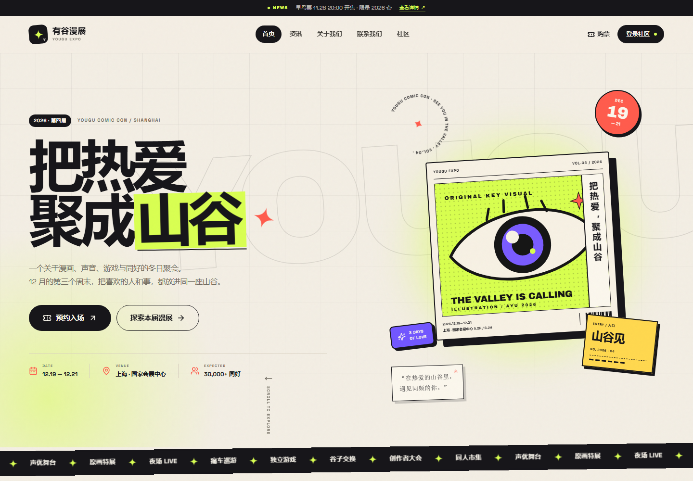

# 有谷漫展 YOUGU EXPO

一个以「有谷漫展」为主题的全栈演示网站。视觉方向是冬日漫展 × Y2K 编辑设计：奶油纸张底色、荧光绿与紫色点缀、手绘感的漫画眼睛、海报与票根元素。

前端使用 React + Vite；后端使用 Express 模拟 API，并将会员、社区、联系表单和订阅数据持久化到本地 JSON 文件。



## 页面

- **首页** `/` — 主视觉、开票倒计时、展会亮点、嘉宾阵容、三日日程、资讯预览、社区预告
- **资讯** `/news` — 分类筛选、关键词搜索、头条与资讯列表
- **资讯详情** `/news/:id` — 文章目录、正文、标签、复制分享、相关阅读
- **关于我们** `/about` — 山谷故事、时间线、价值主张、团队与场馆
- **联系我们** `/contact` — 带校验的联系表单、常见问题手风琴、交通与场馆信息
- **社区** `/community` — 社区动态、话题筛选、点赞、收藏、评论、发帖
- **登录 / 注册** `/login` — 后端会话登录，登录后解锁社区互动

## 启动

```bash
pnpm install
pnpm dev
```

`pnpm dev` 会同时启动：

- 前端：`http://127.0.0.1:5173`
- 模拟后端：`http://127.0.0.1:8787`

打开 `http://127.0.0.1:5173` 即可。Vite 会将 `/api` 请求代理到后端。

也可以分别启动：

```bash
pnpm dev:server
pnpm dev:client
```

## 构建与生产运行

```bash
pnpm build
pnpm start
```

构建完成后，Express 会同时提供前端静态文件和 API，访问 `http://127.0.0.1:8787`。

> 因为社区、登录、联系表单和订阅都依赖后端，部署时需要运行 Node 服务，不能只部署 `dist` 静态文件。

## 演示账号

```text
邮箱：demo@yougu.com
密码：yougu2026
```

也可以在登录页点击「填入演示账号」，或直接注册一个新账号。

## 数据流

- 展会资讯、嘉宾、日程、FAQ、统计、时间线等内容由 `GET /api/content` 提供；种子内容在 `server/seed.js`。
- 注册用户、密码哈希、服务端会话、帖子、评论、点赞、收藏、联系消息和订阅记录保存在 `server/data/db.json`。
- 登录状态使用 `HttpOnly` Cookie 保存，前端不再把账号、帖子或消息写入 `localStorage`。
- `server/data/db.json` 默认被 Git 忽略。删除该文件并重启后端即可恢复初始种子数据：

```bash
rm -f server/data/db.json
pnpm dev
```

## 主要 API

| 方法 | 路径 | 说明 |
| --- | --- | --- |
| GET | `/api/content` | 全站内容数据 |
| GET | `/api/news` | 资讯列表与分类 |
| GET | `/api/news/:id` | 单篇资讯 |
| GET | `/api/auth/me` | 当前登录用户 |
| POST | `/api/auth/login` | 登录 |
| POST | `/api/auth/register` | 注册 |
| POST | `/api/auth/logout` | 退出登录 |
| PATCH | `/api/auth/profile` | 修改昵称/简介 |
| GET | `/api/community/posts` | 帖子列表 |
| POST | `/api/community/posts` | 发布帖子 |
| POST | `/api/community/posts/:id/like` | 点赞/取消点赞 |
| POST | `/api/community/posts/:id/bookmark` | 收藏/取消收藏 |
| POST | `/api/community/posts/:id/comments` | 发表评论 |
| POST | `/api/contact/messages` | 提交联系表单 |
| POST | `/api/newsletter/subscriptions` | 订阅山谷来信 |
| GET | `/api/health` | 后端健康检查 |

## 说明

- 这是一个本地模拟后端，使用 JSON 文件持久化，不适用于生产环境；正式上线建议替换为数据库、密码策略、CSRF 防护和 HTTPS。
- 联系页面会明确提示：消息提交到本地模拟后端，不会真实发送给外部。
- 所有插图均为内联 SVG / CSS 绘制，字体文件本地托管，不依赖外部图片服务。
